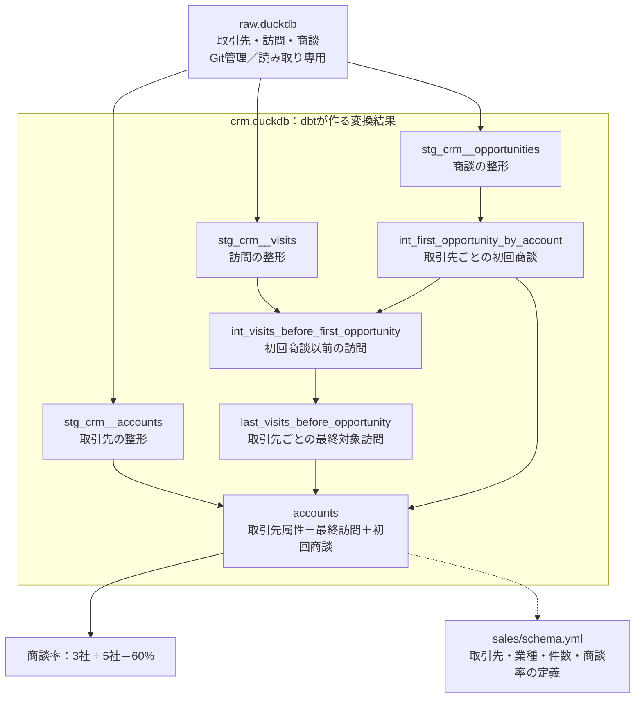

# dbt sample

dbtでduckdbのデータ加工を行うサンプル

DuckDBにあるCRMデータ(取引先/訪問/商談) を、dbtでStaging → Intermediate → Martへ変換するサンプルです。
Staging・IntermediateはVIEW、MartはTABLEとして作ります。



## 実行する

以下は、すべてプロジェクト直下で実行します。

### 1. セットアップ

必要なものは[mise](https://mise.jdx.dev/getting-started.html)です。

uv と Pythonをインストール

```sh
mise install
```

環境を同期し、接続先とバージョンを確認します。

```sh
uv sync --locked
uv run dbt debug --profiles-dir .
```

### 2. raw.duckdb

```sql
SHOW TABLES;
┌───────────────┐
│     name      │
│    varchar    │
├───────────────┤
│ accounts      │
│ opportunities │
│ visits        │
└───────────────┘

SELECT * FROM accounts;
┌──────────────────────────────────────┬────────────────┬───────────────┬──────────────┐
│                  id                  │  account_name  │   industry    │    owner     │
│                 uuid                 │    varchar     │    varchar    │   varchar    │
├──────────────────────────────────────┼────────────────┼───────────────┼──────────────┤
│ 57bef323-e4ed-4de2-9aa0-481895c0f116 │ リベイラの風   │ manufacturing │ カイ         │
│ 97c34324-64a8-4056-bdbf-2e4c1241a1e2 │ ラミーヌ一家   │ retail        │ ディートリヒ │
│ 01b6ec85-86a2-4a06-acd1-e0efff3d5daa │ メガエラの灯火 │ software      │ セオドラ     │
│ 1c95dc57-5180-43ba-8313-458ae24342a1 │ 薔薇の嵐       │ retail        │ レダ         │
│ 79220159-0e82-4d0c-a363-842480a5a6cf │ 白鴉の花嫁団   │ software      │ アナトリア   │
│ c751c6ef-6678-4817-9ead-6560387b2b69 │ リナリアの朝露 │ manufacturing │ オルヘル     │
│ 9eddcfa9-dc7a-4cd7-a352-6fe30d929373 │ 炎の鬣         │ software      │ ベルトラン   │
│ 85e27f25-b9bf-44f5-955f-f6b5ca9f72dc │ 月の嘘         │ retail        │ タリムーン   │
└──────────────────────────────────────┴────────────────┴───────────────┴──────────────┘

SELECT * FROM visits;
┌───────┬──────────────────────────────────────┬─────────────────────┬─────────────────────────────────┐
│  id   │              account_id              │     visited_at      │             comment             │
│ int32 │                 uuid                 │      timestamp      │             varchar             │
├───────┼──────────────────────────────────────┼─────────────────────┼─────────────────────────────────┤
│   101 │ 57bef323-e4ed-4de2-9aa0-481895c0f116 │ 2026-10-01 09:00:00 │  First visit                    │
│   102 │ 57bef323-e4ed-4de2-9aa0-481895c0f116 │ 2026-10-03 09:00:00 │  Last eligible visit            │
│   103 │ 57bef323-e4ed-4de2-9aa0-481895c0f116 │ 2026-10-08 09:00:00 │  After first opportunity        │
│   201 │ 97c34324-64a8-4056-bdbf-2e4c1241a1e2 │ 2026-10-02 09:00:00 │  No opportunity                 │
│   202 │ 97c34324-64a8-4056-bdbf-2e4c1241a1e2 │ 2026-10-09 09:00:00 │  Latest visit                   │
│   501 │ 79220159-0e82-4d0c-a363-842480a5a6cf │ 2026-10-05 09:00:00 │  Only after opportunity         │
│   601 │ c751c6ef-6678-4817-9ead-6560387b2b69 │ 2026-10-04 09:00:00 │  Same timestamp as opportunity  │
│   701 │ 9eddcfa9-dc7a-4cd7-a352-6fe30d929373 │ 2026-10-06 09:00:00 │  Tie lower ID wins              │
│   702 │ 9eddcfa9-dc7a-4cd7-a352-6fe30d929373 │ 2026-10-06 09:00:00 │  Tie higher ID loses            │
│   801 │ 85e27f25-b9bf-44f5-955f-f6b5ca9f72dc │ 2026-10-07 09:00:00 │  First visit                    │
│   802 │ 85e27f25-b9bf-44f5-955f-f6b5ca9f72dc │ 2026-10-10 09:00:00 │  No opportunity latest visit    │
│  NULL │ 57bef323-e4ed-4de2-9aa0-481895c0f116 │ 2026-10-01 09:00:00 │  Missing visit ID               │
│   901 │ NULL                                 │ 2026-10-01 09:00:00 │  Missing account ID             │
│   902 │ 57bef323-e4ed-4de2-9aa0-481895c0f116 │ NULL                │ Missing timestamp               │
└───────┴──────────────────────────────────────┴─────────────────────┴─────────────────────────────────┘
  14 rows                                                                                    4 columns

SELECT * FROM opportunities;
┌───────┬──────────────────────────────────────┬─────────────────────┬──────────────────────────┐
│  id   │              account_id              │   opportunity_at    │         comment          │
│ int32 │                 uuid                 │      timestamp      │         varchar          │
├───────┼──────────────────────────────────────┼─────────────────────┼──────────────────────────┤
│  1001 │ 57bef323-e4ed-4de2-9aa0-481895c0f116 │ 2026-10-05 09:00:00 │  First opportunity       │
│  1002 │ 57bef323-e4ed-4de2-9aa0-481895c0f116 │ 2026-10-09 09:00:00 │  Later opportunity       │
│  4001 │ 1c95dc57-5180-43ba-8313-458ae24342a1 │ 2026-10-03 09:00:00 │  No visits               │
│  5001 │ 79220159-0e82-4d0c-a363-842480a5a6cf │ 2026-10-01 09:00:00 │  Before all visits       │
│  6001 │ c751c6ef-6678-4817-9ead-6560387b2b69 │ 2026-10-04 09:00:00 │  Simultaneous visit      │
│  7001 │ 9eddcfa9-dc7a-4cd7-a352-6fe30d929373 │ 2026-10-07 09:00:00 │  Tie lower ID wins       │
│  7002 │ 9eddcfa9-dc7a-4cd7-a352-6fe30d929373 │ 2026-10-07 09:00:00 │  Tie higher ID loses     │
│  NULL │ 57bef323-e4ed-4de2-9aa0-481895c0f116 │ 2026-10-01 09:00:00 │  Missing opportunity ID  │
│  9001 │ NULL                                 │ 2026-10-01 09:00:00 │  Missing account ID      │
│  9002 │ 57bef323-e4ed-4de2-9aa0-481895c0f116 │ NULL                │ Missing timestamp        │
└───────┴──────────────────────────────────────┴─────────────────────┴──────────────────────────┘
  10 rows
```

### 3. Martの作成までの実行

```sh
uv run dbt run --profiles-dir .
```

`source()`と`ref()`から依存関係を解決し、Staging・Intermediate・Martを順に作ります。
完成する取引先テーブルは`crm.duckdb`の`main.accounts`です。

```sh
uv run dbt show --select accounts --limit 8 --profiles-dir .
```

### 4. 商談率計算

`dbt show`で`analyses/account_conversion.sql`をコンパイル・実行し、結果を表示します。
先に上記の`dbt run`でMartを作成してください。

```sh
uv run dbt show --select account_conversion --profiles-dir .
```

業種別にも計算できます。

```sh
uv run dbt show --select account_conversion_by_industry --profiles-dir .
```

### dbt Chartsのサンプル

`charts/crm_conversion.yml`で、商談率・対象訪問済み取引先数・商談化取引先数、業種別の比較、全取引先の対象判定を表示します。業種を選択すると各表示を絞り込めます。全業種では商談率60%・対象5社・商談化3社が期待値です。

```sh
# 初回・モデルの変更後にMartを作成
uv run dbt build --profiles-dir .

# ダッシュボードを起動
mise run charts
```

起動後、[取引先の商談化状況](http://localhost:8080/crm_conversion/)を開きます。終了はCtrl+Cです。`dbt_charts.yml`で既存の`crm.duckdb`を接続先に指定しており、Semantic Layerを経由せずSQLでMartを集計します。

ChartsはCore v1を依存に持つため、dbt v2の仮想環境と分離しています。タスクは`uvx --python 3.14 --from dbt-charts==0.10.0 dct serve --port 8080`を実行します。初回はネット接続が必要です。Python 3.14はChartsの宣言上の対応範囲外ですが、このサンプルの描画を確認しています。

### 5. テスト

```sh
uv run dbt test --profiles-dir .
```

Notionの例と同じく、SQLとYAMLの標準テストを使います。

SQLテストは、違反行を返すSELECTです。結果が0行なら成功します。`tests/assert_unique_account_id.sql`では、取引先IDの重複を検査します。

```sql
select
    account_id as unique_field,
    count(*) as n_records
from {{ ref('accounts') }}
where account_id is not null
group by account_id
having count(*) > 1
```

標準テストは、各モデルのSQLと同じディレクトリにある`schema.yml`の`columns[].data_tests`に記載しています。例えば`models/marts/sales/schema.yml`では、取引先IDの`not_null`・`unique`と、業種の`accepted_values`を定義しています。日次カレンダーのテストは`models/marts/time_spine.yml`に記載しています。

| 標準テスト | このサンプルでの対象 |
| --- | --- |
| `not_null` | 取引先ID・訪問ID・商談IDなどのNULL検査 |
| `unique` | 各モデルのIDの重複検査 |
| `relationships` | 訪問・商談の取引先IDが取引先モデルに存在すること |
| `accepted_values` | 業種がmanufacturing・retail・softwareのいずれかであること |

### Semanticモデルの定義

Semantic定義は、モデルのSQLと同じディレクトリの`schema.yml`に記載しています。`semantic_model.enabled: true`で有効化し、各列の`entity`・`dimension`でキーと集計軸を宣言します。

| 定義ファイル | Semanticモデル | Entity | Dimension・指標 |
| --- | --- | --- | --- |
| `models/staging/crm/schema.yml` | `visits` | `visit_id`＝primaryの`visit`、`account_id`＝foreignの`account` | `visited_at`（日単位の時間軸）、訪問イベント数 |
| 同上 | `opportunities` | `opportunity_id`＝primaryの`opportunity`、`account_id`＝foreignの`account` | `opportunity_at`（日単位の時間軸）、商談イベント数 |
| `models/marts/sales/schema.yml` | `accounts` | `account_id`＝primaryの`account` | 取引先名・担当者・業種・商談化フラグ、最終対象訪問日時、取引先件数・商談率 |

訪問・商談から取引先属性への通常の結合経路は、共通のEntity名`account`で宣言します。通常の属性JOINで訪問と商談の`foreign`同士を直接結合する定義ではありません。下記の`conversion`型は、共通Entityと時間窓を指定してイベントを対応付ける別の仕組みです。

初回商談と最終対象訪問の対応付けは引き続きIntermediate／MartのSQLで行い、既存の`account_conversion_rate`はその結果に基づく取引先単位の指標です。訪問イベント数と商談イベント数を単純に割った値とは異なります。

#### simple以外の指標例

いずれも、モデルの隣の`schema.yml`内のトップレベル`metrics:`に定義しています。

| 型 | 指標名 | 計算・意味 | 定義ファイル |
| --- | --- | --- | --- |
| `ratio` | `account_conversion_rate` | 商談化取引先数 ÷ 対象訪問済み取引先数（既存） | `models/marts/sales/schema.yml` |
| `derived` | `unconverted_visited_account_count` | 対象訪問済み取引先数 − 商談化取引先数 | 同上 |
| `cumulative` | `visit_count_7d` | 各日を基準とする直近7日間の訪問イベント数。繰り返し訪問も数える | `models/staging/crm/schema.yml` |
| `conversion` | `visit_to_opportunity_rate_30d` | 同じ取引先で30日以内の商談イベントを直近の対象訪問へ対応付けるイベント転換率 | 同上 |

`derived`は`expr`と`input_metrics`、`cumulative`は`input_metric`と`window`で指定します。累積指標は`metric_time`を日単位で指定して問い合わせる想定で、既存の`time_spine_daily`を時間軸に使います。時間軸は2026年分なので、他年のデータを追加する場合は延長してください。

`conversion`は`base_metric`・`conversion_metric`・`entity`・`window`を指定します。30日以内のイベント対応付けの例であり、取引先単位の`account_conversion_rate`を置き換えません。初回以外の商談も対象となります。

`dbt build`での定義読み込み・既存25テストの成功と、`target/semantic_manifest.json`への3モデル・8指標の出力を確認しています。追加した指標のSemantic Layer経由のクエリ実行は未検証です。現在の商談率計算手順は`dbt show`による分析SQLの実行です。[Semanticモデルの公式仕様](https://docs.getdbt.com/docs/build/semantic-models?version=2)、[Derived](https://docs.getdbt.com/docs/build/derived)、[Cumulative](https://docs.getdbt.com/docs/build/cumulative)、[Conversion](https://docs.getdbt.com/docs/build/conversion)

### 列リネージの生成

```sh
mise run lineage
```

strict静的解析でコンパイルし、`target/info_schema/`に列リネージを生成します。生成した列の対応は、次で確認できます。

```sh
uv run dbt show --info column_lineage --limit 20 --output json --profiles-dir .
```

### 6. MCPの実行とClaude Code／Codexへの接続

[公式dbt MCP](https://github.com/dbt-labs/dbt-mcp)で、AIからローカルのモデル定義等を利用できる。

#### サーバーを起動する

```sh
mise run mcp
```

サーバーはClaude Code／Codexが`mise run --quiet mcp`を子プロセスとして起動し、stdioで通信します。別のターミナルでサーバーを起動しておく必要はありません。プロジェクト・profiles・dbt実行パスと`MCP_TRANSPORT=stdio`はmiseタスクが設定します。`mise`がクライアントから参照できるPATHにあることが必要です。

ただし、Semantic Layer関連のツールを利用するには、dbt PlatformのStarterかEnterpriseプランの契約が必要。
[公式料金ページ](https://www.getdbt.com/pricing)

#### Claude Code／Codexから接続する

両方の設定をリポジトリに含めています。どちらもstdioでサーバーを起動するため、CLIからの追加登録は不要です。  
このプロジェクト内でクライアントを起動してください。

| クライアント | 接続設定 | 接続までの操作 |
| --- | --- | --- |
| Claude Code | `.mcp.json` | このプロジェクトで起動し、プロジェクトのMCP設定を承認して`/mcp`で確認 |
| Codex | `.codex/config.toml` | このプロジェクトを信頼した状態で開き直し、`/mcp`で確認 |

## このプロジェクトのファイル

```text
.
├── README.md                         # 手順・構成・期待結果
├── mise.toml                         # Python・uvのバージョン、MCP起動タスク
├── .mcp.json                         # Claude Codeのstdio接続設定
├── .codex/config.toml                # Codexのstdio接続設定
├── pyproject.toml                    # Python依存定義、パッケージ設定
├── uv.lock                           # 依存パッケージの固定結果
├── dbt_project.yml                   # dbtのモデル配置・VIEW/TABLE・対応バージョン
├── profiles.yml                      # crm.duckdbへの接続、raw.duckdbのattach
├── dbt_charts.yml                    # Chartsからcrm.duckdbへの直接接続
├── charts/crm_conversion.yml         # 業種フィルター付き商談率ダッシュボード
├── raw.duckdb                        # 入力データ。Git管理するDB
├── models/
│   ├── raw.yml                       # source('crm', ...)とraw.mainの対応
│   ├── staging/crm/                  # 単テーブルの整形。JOIN・集約はしない
│   │   ├── stg_crm__accounts.sql      # idをaccount_idへ改名、属性を保持
│   │   ├── stg_crm__visits.sql        # 欠損除外・空白除去・訪問日追加
│   │   ├── stg_crm__opportunities.sql # 欠損除外・空白除去
│   │   └── schema.yml                # 説明・テスト・訪問/商談のSemantic定義
│   ├── intermediate/sales/           # JOIN・行の選択・粒度の変更
│   │   ├── int_first_opportunity_by_account.sql     # 取引先ごとの初回商談
│   │   ├── int_visits_before_first_opportunity.sql # 初回商談以前の訪問
│   │   ├── last_visits_before_opportunity.sql      # 最終対象訪問を1件選択
│   │   └── schema.yml                # 説明・IDの一意性などのテスト
│   └── marts/
│       ├── sales/
│       │   ├── accounts.sql          # 全取引先に訪問・商談情報を付加
│       │   └── schema.yml            # 説明・テスト・Entity/Dimension・件数・商談率
│       ├── time_spine_daily.sql      # 2026年の日次カレンダー
│       └── time_spine.yml            # Semantic用の時間軸宣言・テスト
├── analyses/
│   ├── account_conversion.sql        # 全体の商談率
│   └── account_conversion_by_industry.sql # 業種別の商談率
├── tests/
│   └── assert_unique_account_id.sql  # NotionのSQL例：取引先IDの重複検査
├── .github/workflows/dbt.yml          # GitHub Actionsでbuild・showによる分析
├── .gitignore                        # 生成物を除外し、raw.duckdbだけ例外で含める
└── LICENSE                           # リポジトリのライセンス
```

実行すると生成されるもの（Git対象外）：

```text
├── .venv/                            # uvが作るPython仮想環境
├── crm.duckdb                        # dbtが作るVIEW・TABLE
├── target/                           # コンパイル済みSQL・manifest・実行結果
├── logs/                             # dbtのログ
└── .user.yml                         # dbtの匿名利用統計用ID。存在する場合
```

`models/raw.yml`は既存テーブルの参照先を宣言するだけで、入力データを作りません。`raw.duckdb`を更新した場合はDB接続を閉じてから、Mart作成・商談率計算・テストを再実行してください。
